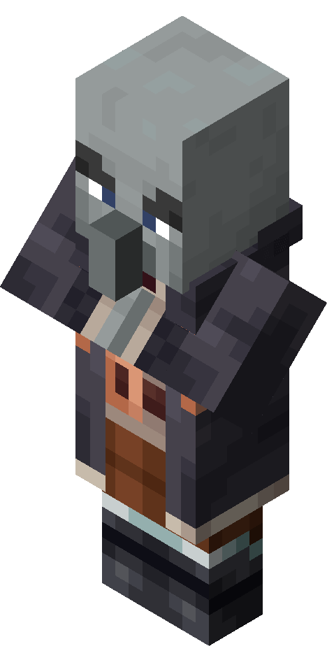
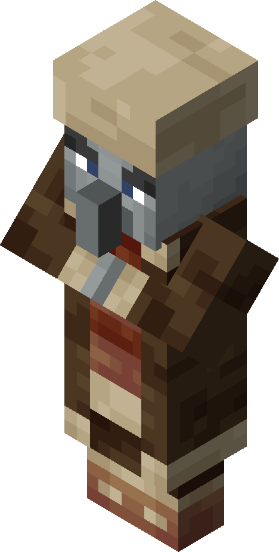
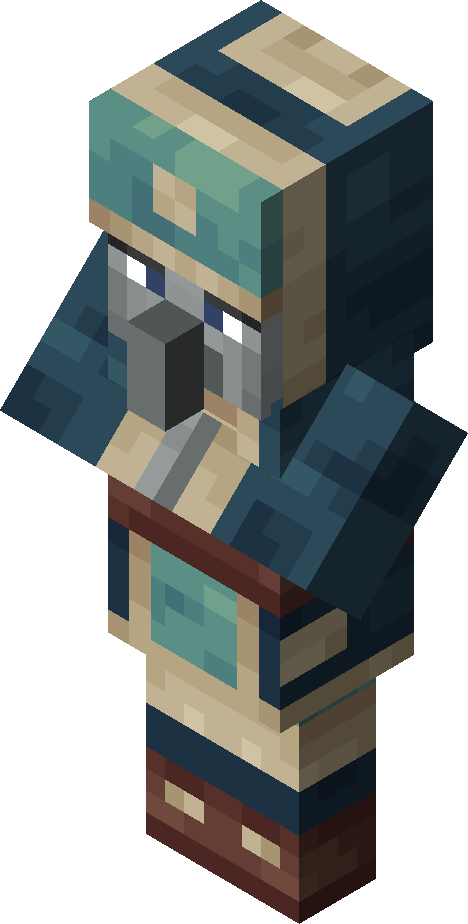
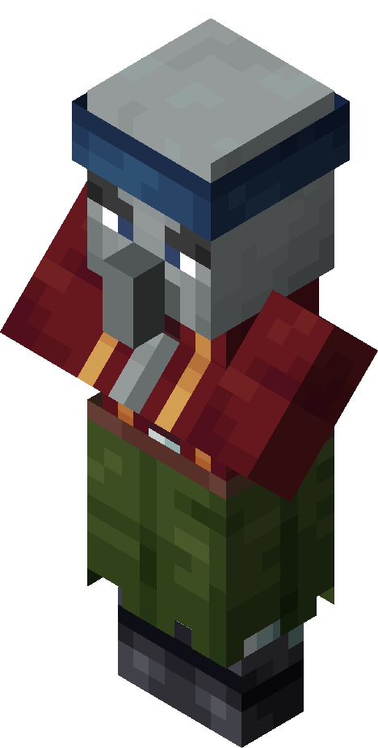
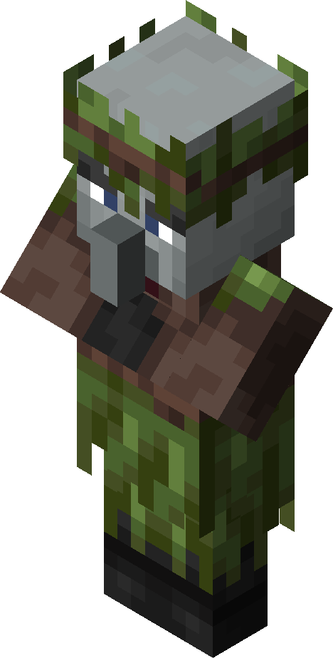
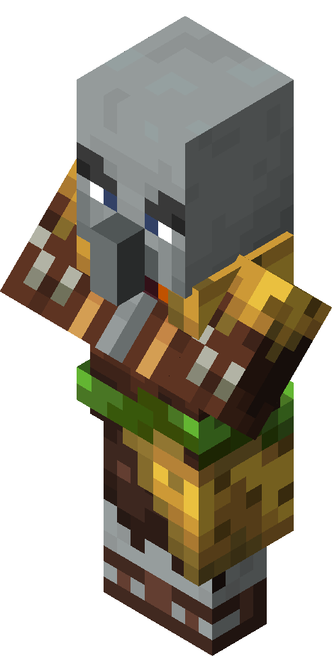
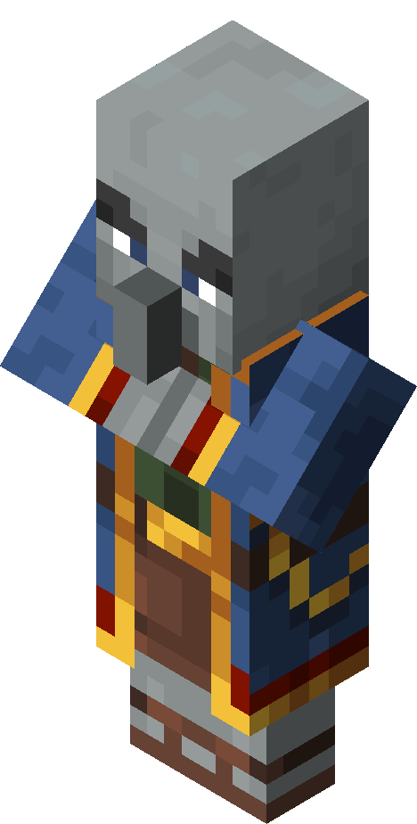
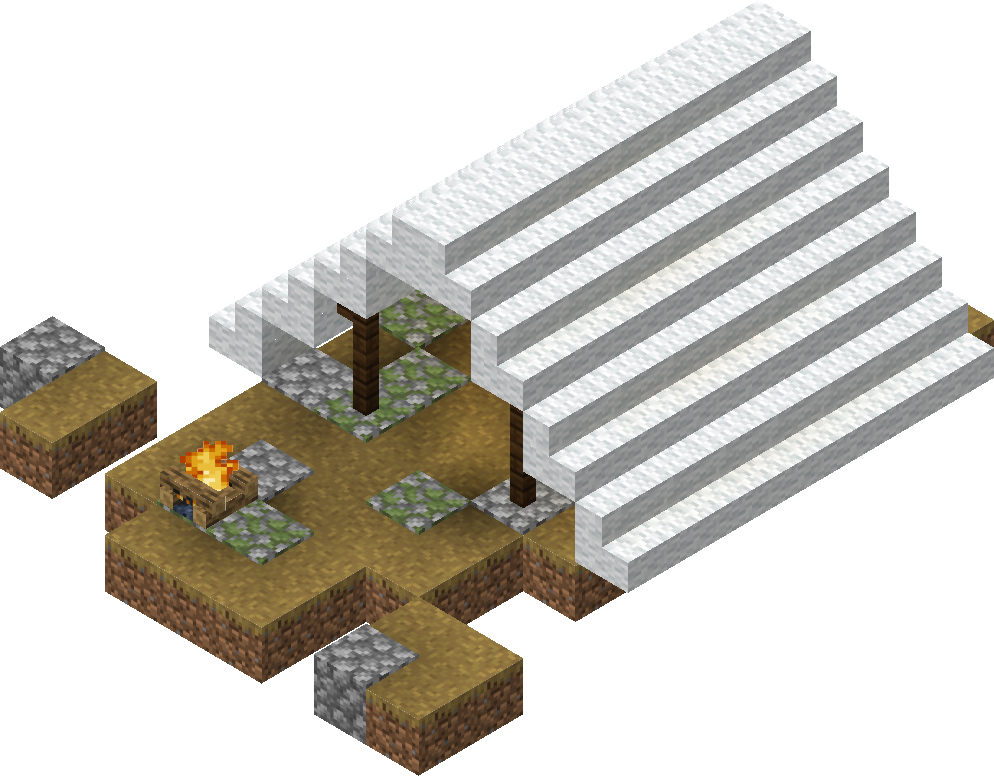
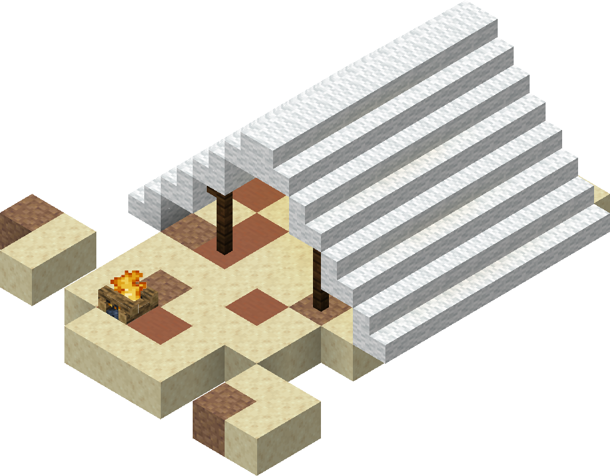
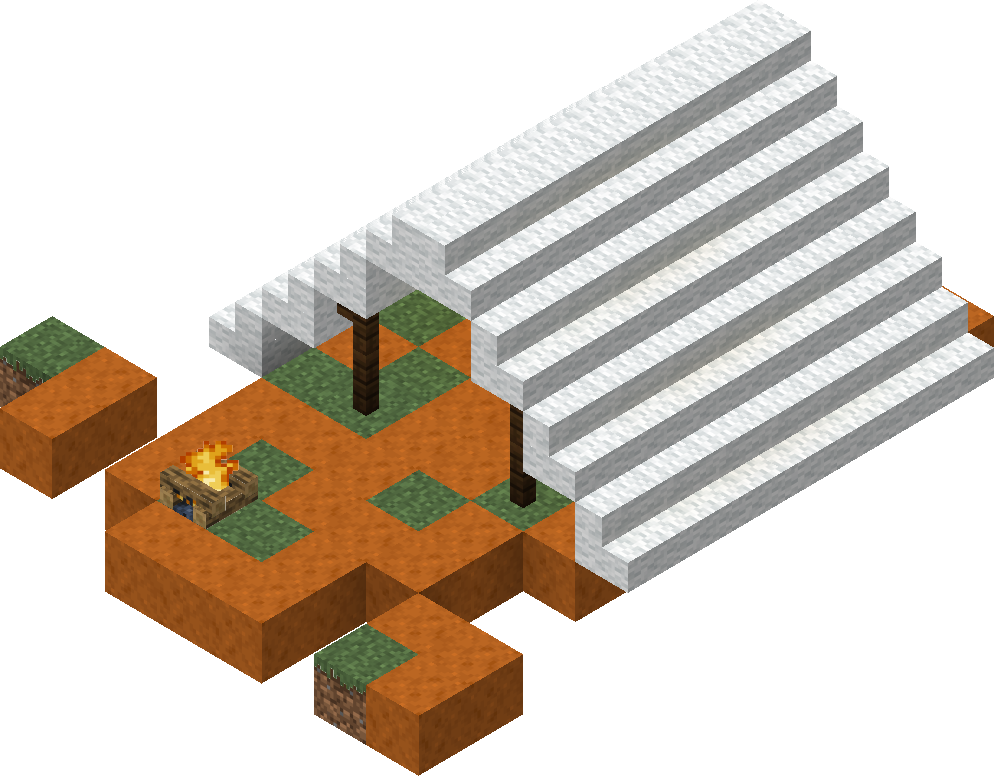

<p align="center"></p>


Pillage the Village is a Minecraft mod addiing the Mercenary, a passive, tameable Illager that can be armed and ordered to follow you, patrol and protect you on your journeys. Mercenary camps generate in selected Overworld biomes, and the rare Volunteer may appear near a tamed mercenary.

## Contents

- [Mercenary](#mercenary)
- [Mercenary Camp](#mercenary-camp)
- [Build](#build)

## Mercenary
      


| Property | Details |
| --- | --- |
| Temperament | Passive |
| Health | 20 HP (10 hearts) |
| Recruitment item | Emerald |

The **Mercenary** is a passive member of the Illagers. It carries no weapon when encountered and does not attack unless it has been recruited and armed. Give an untamed Mercenary an emerald to recruit it. A recruited Mercenary can be equipped with swords, pickaxes, axes, hoes, bows or crossbows. If you replace its weapon, it drops the previous one. Its weapon is also dropped when it dies. An armed Mercenary helps defend its owner. It attacks hostile creatures with exception of Creepers, since they're Illagers they don't attack Witches, Evokers, Vindicators and Pillagers on its own unless owner gets attacked by them.

### Volunteer


The **Volunteer** is a special Mercenary variant. One may appear everyday near an already recruited Mercenary. Volunteer arrivals can be enabled or disabled with the volunteer_spawn gamerule, which is on by default.

## Mercenary Camp
  

**Mercenary Camps** are structures found across a variety of Overworld biomes:
- Plains
- Desert
- Savanna
- Snowy Plains
- Taiga
- Meadow
- Forest
- Old Growth Birch Forest
- Sparse Jungle
- Bamboo Jungle
- Swamp
- Cherry Grove
- Badlands
- Eroded Badlands
- Wooded Badlands

Camps contain three Mercenaries, two straw beds and chest with loot.

### Camp Loot
Camp chests can contain the following items:

| Item | Minimum | Maximum |
| --- | ---: | ---: |
| Bow/Crossbow/Copper Sword/Copper Axe/Iron Sword/Iron Axe | 0 | 1 |
| Goat Horn (any of eight instrument variants) | 0 | 1 |
| Copper Ingot/Iron Ingot (combined) | 4 | 10 |
| Raw Beef/Raw Mutton/Raw Porkchop/Potato/Carrot/Apple/Bread | 3 | 8 |
| Empty Map | 0 | 1 |
| Bundle | 0 | 1 |
| Dark oak log | 4 | 12 |

*Each chest selects exactly one weapon. The selected weapon may be enchanted.*

## Build
This repository contains separate NeoForge and Fabric projects, each with its own Gradle wrapper.
To build from the repository root on Windows:

```powershell
.\NeoForge\gradlew.bat build
.\Fabric\gradlew.bat build
```

On Linux or macOS:

```sh
./NeoForge/gradlew build
./Fabric/gradlew build
```

## License

The mod code is distributed under the GNU Lesser General Public License v3.0 only. See [LICENSE](LICENSE).
